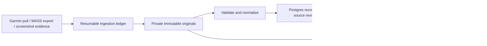

# Proposed database and ingestion design v2

6 November 2026. **Design for review, not an applied migration.** No personal
records were inserted into Supabase during this work. Read-only Garmin probes
and FIT inspection are saved only under ignored private-data/design-audit.

## Recommendation

Use PostgreSQL for queryable records, ownership, revisions and ingestion state;
private Supabase Storage for immutable originals and large sensor streams;
deterministic versioned projections for charts and analysis. Preserve information
before choosing how much of it the UI understands. Do not bulk-load into the
existing single-library JSONB document and call that the finished architecture.

This is a concrete starting design, not a promise of zero future migrations.
The protection against future nuances is source preservation, explicit grains,
versioned transformations and reversible cutover—not anticipating every future
screen or converting every provider field into a column now.

## What was actually inspected

- Existing local library: seven Garmin activities, 5,768 normalized samples,
  available HR on all seven, six with GPS; no saved owner check-ins. Serialized
  snapshot about 1.70 MB before the newly discovered activities/daily streams.
- Live list now returns eleven activities: five running variants, four walks,
  one indoor cycling and one breathwork. The existing running/walking importer
  would skip two sports. All eleven must have an inventory outcome.
- The new FR965 outdoor run's original FIT decoded without errors and has 2,183
  GPS-bearing records plus HR, power, cadence and running dynamics. New treadmill
  and indoor cycling originals also decoded, with no GPS. No synthetic map route
  is assigned to an indoor session.
- Actual FITs include event, session, lap, split, device, zone and metadata
  messages, beyond the UI's current sample subset. Record fields include
  vertical oscillation, ground-contact/stance time, vertical ratio and step
  length. Preserve originals; do not discard these because no UI exists yet.
- Read-only probes for 5 November returned daily summary, daily HR (687 sample
  entries), sleep with score/need fields, and HRV (49 readings plus summary).
  These response shapes are verified; historical coverage and every endpoint's
  units/semantics still need adapter validation. An object response does not
  prove every nested metric has a measurement.
- MASS: 29 weights, five session rows (four active, one deleted), two sparse
  wellness rows; profile/goal settings exist; measurement/nutrition collections
  are empty. Active sessions are two known Strength and two Cardio labels.
- Historical screenshots: six images describe two runs. Source summary/splits
  are available; timestamps have limited precision; there is no sensor stream.
  NRC's displayed zero HR means unavailable. Provider medal assertions do not
  establish a calculated best effort or race classification.

Live list totals are an observation, not a hardcoded acceptance total: perform
a fresh manifest when backfill starts. User-reported successful hosted Gemini
and Supabase checks are accepted as context, not a new independent integration test.

## Table contract

Sixteen target application tables, including two existing tables. During cutover
the existing fitness_libraries table remains a seventeenth, legacy bridge.
Supabase-managed auth/storage tables are not duplicated. Every private row has
owner_id. All entity references enforce the same owner through composite FKs.

| Table | Exact grain / main fields | Reason and integrity rule |
| --- | --- | --- |
| `fitness_owners` (existing) | One allowed Auth user; owner_id, configured IANA timezone, settings_version | Identity/owner settings, not a duplicate password store. Provider-local dates remain independent of this display preference. |
| `source_accounts` | One owner/provider/account connection; provider, external_account_id, sync configuration, capability status | Separate Garmin/MASS/screenshot origins and credential rotation from record identity. Credentials remain server secrets, not table values. Unique owner/provider/external account when known. |
| `ingestion_runs` | One backfill/import/sync attempt; source, adapter version, scope/range, start/end, state, manifest totals | Explain what a run attempted and whether it was complete. No single last-sync timestamp pretending all domains succeeded. |
| `ingestion_items` | One logical activity revision or health endpoint/date work item; run, external key/domain, cursor, asset refs, outcome, attempts, next_retry_at, lease | Durable retry and coverage ledger. Outcomes distinguish pending, processing, committed, empty, unsupported projection, unavailable/permission, retryable/permanent failure. A skipped item is never counted as imported. |
| `raw_assets` | One owner/content-hash object; SHA256, private object key, media/encoding, bytes, schema/parser labels, verification state | Immutable FIT, archive, JSON or screenshot evidence; request observations/fetch dates live in ingestion_items so equal bytes from different requests keep their separate provenance. No auth headers or credential-bearing URLs stored. |
| `activities` | One canonical workout container; UUID, sport/subsport, UTC start nullable, original wall time/date, precision/timezone provenance, separate elapsed/timer/moving/running seconds, distance_m, selected summary fields, status/revision | A stable ID survives provider corrections, parser upgrades and source merges. Missing HR/GPS/distance stays null; sport is extensible, not restricted to Run/Walk. Parent/component markers prevent multisport double counting. |
| `activity_sources` | One immutable source revision linked to an activity; account, provider entity ID or owner import ID, revision/hash, upstream update/deletion info, assets, source-specific summary, supersedes | Unique owner/account/entity/revision. Multiple aliases and differing Garmin API/FIT/screenshot values remain visible. Current projection points to a specific accepted revision, not whichever fetch finished last. |
| `activity_segments` | One session/lap/split/interval within an activity/source revision; kind, sequence, parent segment, source ordinal, nullable start/end/distance/time, extensions | Device laps, workout intervals, FIT split messages and elapsed sample blocks are different things. Multiple FIT sessions are representable; unsupported parsing is explicit rather than permanent data loss. Derived blocks carry algorithm/version provenance. |
| `activity_feedback` | One user feedback revision for an activity; questionnaire kind/version, answers, completion state, note/context, base_revision | User input is independent of Garmin data. Edits append revisions and reject stale saves. Unknown answers remain unanswered; strength uses a different questionnaire from runs. |
| `body_measurements` | One source measurement-event revision; source ID, dateKey, measured_at nullable, weight_kg nullable, optional measurement JSON, upstream update/deletion, asset | Multiple readings on one date are valid. MASS t and dateKey are preserved separately. Garmin/MASS same-date weights are not silently merged or averaged across providers. |
| `health_daily` | One owner/source/calendar-date/domain revision; domain, typed small summary, nullable standardized metrics, source values/extensions, assets, coverage, provisional/final state | Domains distinguish daily summary, HR, HRV, stress, Body Battery, SpO2, hydration and source-reported wellness. No single daily row that a partial response can blank out. Cross-source selection is per metric, with provenance. |
| `sleep_episodes` | One source sleep episode revision; source ID/key, provider sleep date, UTC start/end nullable, main sleep/nap/unknown classification, stage durations, scores/metadata, assets | Overnight sleep crosses dates; a daily record is not necessarily one episode. Create episodes only when source intervals substantiate them. Aggregate nap totals stay aggregates, not invented intervals. |
| `derived_metrics` | One target/metric/algorithm/input-fingerprint result; numeric/unit or bounded structured value, eligibility, method/version, cited inputs/assets | Reproducible statistics, quality flags, route/display bundles and comparable-run rules. Ineligible is explicit, not zero. Large output is an object reference. |
| `analysis_reports` | One analysis attempt/result for an immutable evidence pack; dataset mode, evidence hash/citations, schema/prompt/model/config versions, status, validated output | Separate generated prose from measurements. Current free-only policy permits synthetic Gemini input only; no personal history is sent just because it is now in SQL. |
| `record_changes` | One accepted mutation/merge/unmerge/user edit; actor, target, revision pointers, reason, timestamp, changed-field metadata | Explain and reverse identity/precedence decisions. Does not duplicate full GPS or every raw blob. Sensitive before/after values remain in their versioned record/evidence, not general logs. |
| `fitness_sync_leases` (existing) | One owner sync lease with expiry/fencing identifier | Prevent duplicate workers. Expired worker cannot publish over a new claim. Existing global owner lease is sufficient initially; provider-specific parallelism can be added without changing record identity. |

Tables for detailed strength sets/reps, versioned plans and nutrition are deferred
until actual inputs/features require them. Their original exports are retained.
No invented per-exercise rows are created from a MASS focus label. Preserve
provider settings/goals/zones as versioned assets; add a typed query projection
when a screen/calculation needs it. Do not use current profile weight as a dated
weigh-in or current age/goal as a historical fact.

Concrete key/type rules for implementation:

- Internal entity IDs are UUIDs. Provider IDs are text (do not depend on JavaScript
  safe-integer limits). Content fingerprints are SHA256; counts/offsets are
  integers, measured values retain source precision, instants are timestamptz,
  dateKey is date and original wall time is retained without inventing an offset.
- Body source revisions are unique by owner/account/source-record-key/content
  hash; current selection respects upstream update/deletion ordering. Health
  revisions are unique by owner/account/date/domain/content hash; each typed
  adapter declares its specific nullable fields and units. Example HRV fields
  include last-night average in verified ms and provider baseline/status; HR
  includes resting/min/max and an object ref; steps is a count; hydration is ml.
- Sleep source IDs identify revisions when available. If no stable episode ID
  exists, episodes belong to a parent response revision and ordinal; replace
  the accepted snapshot as a unit rather than guessing identity from mutable
  start/end times. A date correction must supersede the old projection too.
- Metric inputs record source revision IDs, relevant feedback revision IDs,
  algorithm and parameters. Model cache fingerprints also include model,
  thinking/generation configuration, schema and prompt versions.
- Workout bodies and profile/zone payloads are versioned evidence assets.
  Summary columns select explicit field paths and source revisions. No direct
  writable client projection view can overwrite provider or owner evidence.

## Representation choices that prevent expensive mistakes

**Relational where we query; bounded JSON where providers vary.** Typed indexed
columns hold dates, sport, ownership, identifiers, units and common metrics.
Provider extensions carry uncommon fields with a schema/version label; originals
retain everything. JSON is not an excuse to store an entire athlete in one row.

**Large streams are private objects, not API-wide JSON or millions of SQL points.**
Keep original FIT and exact JSON response bodies. Produce compressed, versioned
per-activity/per-day sample bundles with UTC timestamps, elapsed sample times,
nulls, session boundaries, pause/events, unit metadata and field coverage.
Preserve all decodable FIT messages/unknown fields in evidence; normalize only
fields whose meaning is verified. Partition large daily bundles by domain/day;
split oversize activities into bounded time chunks with a manifest and shared
sample indexes. The adapter checks compressed AND decompressed size limits.

Activity/health detail fetches request one bundle/window, not all history.
Cross-run calculations operate on stored summaries/metrics; algorithms needing
full streams process selected objects server-side. Future SQL sample querying
can add a point projection without re-recording the underlying workout.

**Dates and units are part of the schema.** UTC instants, source-local wall
timestamps, dateKey and IANA timezone/offset provenance are distinct. Sydney DST
does not turn a dateKey into a different date. Screenshot date-only/minute data
does not become an observed midnight/second timestamp. Store source numeric
precision and convert units only through verified adapters: meters, seconds,
kg, bpm, watts. Running cadence can require left/right interpretation; cycling
RPM must not inherit the running cadence multiplier. Unknown units quarantine
the affected metric while retaining source data.

**Source, derived value and selected display value are separate.** Garmin API
and FIT may disagree; keep both with field-level projection provenance. Preserve
all duration bases. The low-distance treadmill recording keeps raw distance/HR,
but pace is ineligible. Indoor cycling retains its summary/HR even if it has no
usable distance or cadence. Track, indoor and outdoor sessions remain distinct
for comparisons. Raw gaps are not interpolated into evidence.

**Revisions solve corrections, not just duplicates.** Provider ID identifies an
entity; a hash identifies a version/blob, not universally a workout. Exact
owner-scoped FIT identity can attach manual/API aliases; approximate date/time/
distance matches require review. Source priority is field-specific and explicit;
owner corrections are overlays, not edits to originals. A source deletion hides
that source revision without erasing other sources/check-ins. MASS tombstones
beat older revisions; omitted rows are not deletion. Unknown upstream deletion
semantics result in missing-upstream review, not automatic removal.

## Garmin capture scope and schedule

The inspected Personal API spec has 26 read routes. Scope is **all accessible
training-relevant data**, with an endpoint capability/coverage manifest—not a
claim that every Garmin Connect screen is exposed by this API.

1. Inventory all activity types and fetch detail, available workout association
   and original archives. Capture even sports whose rich UI adapter is absent.
2. Backfill daily summary, daily HR, sleep, HRV, stress, steps, Body Battery,
   SpO2, hydration and Garmin weights where available. Record zones/settings/
   goals as configuration evidence, not invented measurements.
3. Nutrition and menstrual-cycle endpoints are documented but outside this
   running/strength scope. Do not silently pull unrelated sensitive domains;
   mark excluded-by-scope and extend explicitly if wanted.
4. Start recent health windows around the new watch, then use documented range
   endpoints to discover older coverage. Do not assume pre-FR965 health is absent:
   older FR255 activities exist. A no-data run is coverage evidence, not a reason
   to issue unbounded daily requests back to an arbitrary year. Historical range
   backfill is checkpointed and bounded; unresolved history is labelled partial.
5. Capture today as provisional; re-fetch yesterday/recent seven days for delayed
   sleep/HRV corrections. Revisit recent activity revisions and perform periodic
   older-history audits since change feeds/updated-since guarantees are not
   assumed. Retain only changed content versions, but record every fetch outcome.

Initial manual catch-up uses small date/page batches, bounded concurrency and
per-item checkpoints. No one giant Vercel invocation. Use range endpoints where
documented; validate actual range caps/rate limits instead of guessing them.
Concurrent new activities can shift offset pagination: deduplicate IDs and repeat
the inventory boundary until stable, recording the snapshot/coverage manifest.
Safety caps mark a run partial and leave a continuation, never silently truncate.

401 renews the Garmin access token once; 429 honors Retry-After and defers when
the run budget is exhausted; bounded transient retries leave resumable failures.
403 is a permission/capability investigation, not fabricated empty data. Expected
204/empty, unsupported domain, revoked credentials and network failure are
different ledger outcomes. Tokens stay server-side and out of raw captures.

## How initial filling works

1. After design review, create additive v2 migrations and adapter/read-model
   tests using synthetic fixtures. Preserve the existing schema/local backup.
2. Verify live owner isolation, object access and an export/restore on synthetic
   data. Create source connections and an ingestion manifest under the owner.
3. Inventory live Garmin again. Capture each response/archive, verify hashes and
   upload private immutable objects; then parse/validate into staging work items.
4. In a small DB transaction, publish the canonical records, source revisions,
   segment/health projections, metric invalidations and the committed item state.
   Only publish references to verified uploaded objects. A bad metric need not
   erase a valid raw activity; flag projection coverage explicitly.
5. Continue daily-health windows and failures from checkpoints. Each accepted
   correction creates a revision and invalidates only dependent derived results.
6. Import the already-inspected MASS export and reviewed screenshot candidates
   through the same provenance pipeline. Carry all 29 weights, five MASS source
   session rows including the tombstone, sparse wellness and six images/two
   reviewed activities. Do not count six images as six workouts. No new Strava
   API or live MASS integration is assumed.
7. Reconcile manifest counts/IDs/assets/hashes and sampled field values against
   Garmin and local evidence; produce a completeness report by domain/date.
   Re-import once to prove idempotency; prove correction and restore behavior.
8. Switch UI reads to v2 behind a feature flag only after those checks. Current
   snapshot becomes a read-only fallback, never a second writable authority.

Object storage and PostgreSQL do not share an atomic transaction. An object
upload followed by a DB failure leaves a private unreferenced object, not a
published half-workout. Retry by hash, verify existing bytes, and reconcile
orphans; delete only when no accepted revision/backup references them. A finished
DB commit whose HTTP acknowledgement was lost is returned by idempotency key.
Worker fencing and per-record optimistic revisions prevent stale commits.

## Queries, security and migration boundaries

Index owner/date/ID for calendar pagination; owner/sport/date for comparisons;
owner/source/external-key/revision for deduplication; owner/date/domain for health;
and run/status/next_retry_at for jobs. Unique constraints, not UI code, enforce
entity/revision identity. Avoid broad JSON GIN indexes and stream indexes until
specific query plans require them. Use keyset pagination and narrow column reads.

RLS protects every owner row, including jobs, revisions and analysis reports.
Composite foreign keys stop cross-owner references even under privileged worker
writes. Security-invoker views/RPCs preserve RLS; server jobs bind an explicit
allowlisted owner. Start with authenticated explicit sync, not an unauthenticated
cron endpoint. Never accept owner_id from an untrusted UI as authorization.
No service-role key in client code. Signed object links are short-lived and
issued only for authorized committed evidence. Do not log private coordinates,
notes, access tokens or provider response bodies in public error logs.

Migration is additive and tested against the current cloud adapter: new tables
are not automatically used by existing v1 handlers. Cut over read/write routes
together with a write freeze/lease, revision checkpoint and rollback plan. If
v2 writes have occurred, rollback must preserve/replay them; do not silently
point back to a stale v1 snapshot. Record migration versions and keep export
compatibility. Removal of v1 is a later explicit migration after recovery checks.

Backups export normalized records/revisions, original evidence, version manifests
and checksums, in bounded chunks rather than one huge HTTP payload. Restore into
an empty isolated target and verify source/canonical counts and hashes. Owner
deletion is a deliberate coordinated DB/object purge; source tombstones are not
the same as deleting the owner's private archive.

## Free-tier fit and limits

Current Supabase Free pricing lists 500 MB database, 1 GB files and finite egress;
Vercel function request/response payloads are limited to 4.5 MB. Those limits
reinforce indexed summaries plus compressed private objects and narrow reads.
No paid service, mandatory vector database, live geocoding or automatic upgrade.
Measure actual compressed FIT/JSON/stream sizes during the first capture and
forecast growth; today's small record count is not a lifetime capacity estimate.

Track database/object bytes and egress; stop new capture before a configured
capacity threshold, preserve existing data, report partial coverage and offer
a verified local archive. Retain originals rather than silently deleting health
history to make a free tier fit. Regenerable chart bundles can be pruned safely
by version/reference rules. Free service uptime/backups are not assumed to be
an unlimited or guaranteed durable archive. Local export remains necessary.

## Maps and analysis implications

Store original WGS84 positions privately with sample timestamps/indexes. Map
display uses a gap-aware simplified derived route plus full-resolution detail
on demand. Street names come from a basemap provider, not a new SQL table of
all streets. Never replace actual GPS with a map-matched path or generate GPS
for indoor/screenshot activities. An external basemap can learn the viewed area
from tile requests even without receiving the full route; provider/policy and
privacy need an explicit review in the map feature.

Insights cite immutable source/metric revisions. Recomputing a metric or editing
a check-in invalidates affected evidence hashes. Provider sleep/HRV scores are
labelled provider values, not independently validated readiness. Current Gemini
Free policy still restricts real personal inputs; database filling does not
authorize sending health data to it. Future local intelligence can consume the
same deterministic evidence without changing source storage.

## Alternatives considered

| Alternative | Why not choose it now / retained escape hatch |
| --- | --- |
| Keep all history in fitness_libraries JSONB | Whole-library transfers, coarse write conflicts, weak per-record queryability and rapid growth with daily streams. Retain only as a migration bridge/export format. |
| Make every sensor sample a SQL row immediately | More storage/index/write overhead on a free personal app, and no current whole-history SQL-point query requirement. Preserve lossless objects; add a relational sample projection if real queries justify it. |
| Normalize every Garmin field into dedicated columns/tables | High schema churn and mostly unused data. Use typed common fields plus versioned extensions and immutable originals. |
| Raw JSON files only | Cheap fidelity, but poor calendar querying, joins, deduplication and concurrent edits. Keep raw evidence alongside relational records. |
| One universal metric/value table for everything | Units/grains/ownership/queries become opaque. Use domain tables for activity, body and health; derived_metrics holds calculated outputs only. |
| Automatic matching by date/distance or newest fetch wins | Can merge different sessions, overwrite owner notes or revive deleted MASS records. Stable IDs plus explicit review and source revisions instead. |
| Re-fetch Garmin on every screen load | Slow, quota-sensitive and unusable during provider failures. Persist first; explicit bounded synchronization updates the read model. |
| Full event-sourcing/CQRS/microservices/data lake stack | Operational complexity without demonstrated personal-app value. Version source records and keep a small change ledger in one application/database. |
| PostGIS/segment engine/vector search now | Neither street-labelled map display nor the current calendar needs spatial SQL or embeddings. Keep coordinates/indexable metadata and add spatial indexing when proximity/segment queries exist. |
| AI decides identities/units or writes database changes | Non-deterministic source corruption and unsupported claims. Deterministic adapters/constraints own data; model output never mutates source records. |

## Gates before real population

- Different-owner read/write/object access and cross-owner FK attempts fail.
- Exact replay, duplicate FIT alias, unknown sport, multisport, revised summary,
  late sleep correction, sparse/null HR/GPS and malformed source are accounted for.
- MASS delete then old import cannot resurrect a row; user feedback survives a
  Garmin update; uncertain screenshot dates/splits remain uncertain.
- Source UTC/local/DST boundaries, sample cadence/units and timer/moving/elapsed
  differences pass meaningful fixtures; sparse sleep/nap data is not invented.
- Upload failure, DB failure, timeout, lost acknowledgement and expired worker
  can resume without duplicate canonical records or published broken objects.
- App calendar/detail/route/weight queries work through the new narrow read model;
  source reconciliation and an isolated complete restore pass before UI cutover.

## Sources and evidence

Provider capability observations came from read-only live requests and the local
Garmin OpenAPI snapshot. Only four daily-health endpoints were probed live; the
remaining documented endpoints are ingestion candidates, not verified coverage.
No final free-tier lifetime, full historical coverage or production auth result
is inferred from these probes.

- [Garmin Personal API Swagger](https://developer.garmin.com/gc-developer-program/personal/swagger-docs/)
- [Garmin authentication and owner-only scope](https://developer.garmin.com/gc-developer-program/personal/personal-faq/)
- [Official FIT SDK](https://github.com/garmin/fit-javascript-sdk)
- [Supabase JSON support](https://supabase.com/docs/guides/database/json)
- [Supabase row security](https://supabase.com/docs/guides/database/postgres/row-level-security)
- [Private storage access](https://supabase.com/docs/guides/storage/security/access-control)
- [Supabase current Free limits](https://supabase.com/pricing)
- [Vercel function limits](https://vercel.com/docs/functions/limitations)
- [Gemini unpaid data terms](https://ai.google.dev/gemini-api/terms#unpaid-services)
