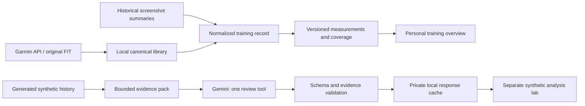

# Training intelligence: evidence before interpretation

Current update, 7 November: F08 adds owner-consented personal run briefings with a
new evidence/schema/client, private reports and Account AI preferences. See
[F08](../features/F08-coaching-intelligence.md). The synthetic-only pipeline below
remains the local lab's historical contract; it no longer describes opted-in
hosted member generation. Gemini 3.6 high thinking passed the current synthetic
provider test; 3.8/3.7 returned 503. No provider billing change was made.

Implemented 5 November 2026. The owner's current direction is to defer database
setup, use the local Garmin library for UI, and use **synthetic data only for
Gemini**. Billing was confirmed active; the Gemini key has not been added. No
live model response or personal-data model analysis has been verified.

## One pipeline, two explicit data modes

There is deliberately no connection from personal records to Gemini. The POST
route accepts only `{ "dataset": "synthetic" }`; it never accepts supplied
records, prompts, models, URLs or tools. The model client independently rejects
a pack marked personal. A later real-data analysis increment requires an
explicit scope change; adding a key does not enable personal-data transmission.

## Data engineering

`training-data.mjs` builds `training-evidence-v1` from canonical library records
and owner-supplied screenshot summaries. It deduplicates source aliases, orders
by activity date, supports last-90-day/all-imported windows, rejects future
records beyond a one-day allowance and preserves missing measurements as null.
Weekly bins start Monday. Empty bins mean no imported activity, not inactivity.

Duration uses timer, running, moving, then elapsed time in that order, with its
basis retained. The overview labels its aggregate as mixed bases; this is not a
physiological training-load measure. Screenshot pace is retained as displayed,
so rounding differences do not overwrite source evidence. Distance below 10 m
or pace over 60 min/km is unsuitable for the pace visualization. Original source
values remain unchanged. Heart rate and GPS have independent coverage counts.

The overview currently joins private historical summary files with the saved
Garmin library at read time. Library export/restore covers the library; those
historical seed files and screenshot evidence still need their own local backup.
This slice does not claim to have migrated the screenshot archive to a database.

For descriptive comparisons, eligible sessions must be outdoor running, exclude
track/indoor activity, contain at least 1 km and ten minutes, use timer time,
and have moving/timer ratio at least 0.8 when moving time exists. A candidate
baseline must be seven to forty-two days earlier and within twenty percent of
the latest eligible distance. These are conservative engineering filters,
**not validated physiological comparability criteria**. They do not control
weather, terrain, effort or sensor differences. No fitness gain is inferred.

The evidence pack includes at most thirty most-recent session summaries,
relative day offsets, sport/environment/source/time basis, limitations and
deterministic facts. History aggregates explicitly cover the chosen imported
window, and truncation is flagged. Session references are aliases such as s01;
canonical IDs stay in a separate mapping. No names, coordinates, exact dates,
free-text notes, source payloads, FIT bytes, credentials or subjective symptoms
are serialized to the model. Current check-in completion is available to the
overview engine; check-in answers, MASS and strength analysis are not included
in this first contract.

## Model and official API

Google currently marks **gemini-3.5-flash deprecated** and routes it to 3.6.
Default to the supported explicit `gemini-3.6-flash` model rather than relying
on that redirect. `GEMINI_MODEL` is configurable server-side. This is a chosen
successor to the requested model, not a claim that 3.6 is Google's newest model.

The server uses the documented Interactions REST endpoint with the key in the
`x-goog-api-key` header, `store:false`, medium thinking and a 4,096-output-token
limit. `store:false` disables interaction persistence; it is not a claim that
all service logging/retention disappears. One named function is supplied:
`publish_training_review`. Forced allowed-tools mode requires that function.
There is no database, filesystem, search or arbitrary code tool for the model.

## Output contract and validation

`training-review-v1` permits a concise summary, up to four findings, up to two
chart selections and up to two follow-up questions. All object fields are
required, extra properties are forbidden, and fact/session references are
restricted to enums built from this request's evidence. The response includes
the exact evidence hash and version. Confidence is an evidence category, not a
calibrated probability.

Only a complete/requires-action response with exactly one correct function call
and object arguments enters validation. Ajv checks the complete JSON Schema
locally, including lengths Google may not enforce. Evidence checks reject
unavailable chart measurements, unknown IDs, pace findings without an eligible
comparison, false insufficient-history assertions and coverage findings without
an actual gap. A prose guard rejects digits, markup, links and selected clinical,
readiness and fitness-improvement language. Every finding cites known facts.

These checks substantially constrain output, but do not prove that every
natural-language interpretation follows from its citations. Lexical checks can
miss paraphrases or over-reject benign language. This is a bounded analysis
prototype, not a medical system or a completed hallucination-proof evaluator.
The next quality stage should evaluate generated responses against a curated
set of sparse/paused/indoor/source-mixed histories after live access is verified.

Charts cannot contain model-generated values. The model selects a supported
chart type and session references; the UI resolves all values from the same
evidence registry. Numeric evidence is shown separately from escaped prose.
Personal deterministic observations and synthetic model findings remain in
separate sections with explicit labels.

## Reliability and privacy

- One request per evidence/model/prompt/schema fingerprint. Concurrent requests
  share one promise. Validated results survive reload under ignored
  `private-data/analysis`; invalid results are never cached.
- Cache provenance includes requested/returned model, timestamp, evidence hash,
  prompt and schema versions. Cached responses are revalidated on read.
- One-minute process-local cooldown after a request attempt. No automatic paid
  retries. This is a local cost guard, not distributed production rate limiting.
- Fixed Google HTTPS destination, redirects rejected, ninety-second timeout,
  bounded response size. Provider error bodies and keys never reach the UI.
- Google quota/access/network/incomplete/schema errors preserve measured data.
  No invented replacement insight. No key field is rendered in the browser.
- Public Vercel is synthetic preview only. Its analysis status is disabled;
  no model request executes from the public deployment in this increment.

## Run it

1. Run `npm ci`, then `npm run dev` in the application directory.
2. Open `http://127.0.0.1:4173/training`. Sync Garmin explicitly as needed.
3. Add `GEMINI_API_KEY` to local `.env` when ready. Do not paste it into chat.
4. Reload and choose **Test synthetic review**. Only generated runs are sent.
5. Inspect citations and provenance. Repeating the same test reuses the saved
   validated response. Changed evidence/model/prompt/schema creates a new key.

Gemini HTTP behavior is currently tested with mocked responses. A live provider
call and generated-output evaluation remain pending the key. Private Supabase
provisioning, real-data AI calls, strength/MASS context and scheduled analysis
remain separate work.

Optional visual fixture: `node tests/preview-training.mjs` serves a clearly
labelled mocked review on port 4189 without provider requests. Modes `empty`
and `invalid` exercise their respective UI states. This is test tooling, not a
live Gemini integration. Stop it before changing modes.

## Official references (checked 5 November 2026)

- [3.5 Flash deprecation](https://aistudio.google.com/docs/models/gemini-3.5-flash)
- [3.6 Flash capabilities](https://aistudio.google.com/docs/models/gemini-3.6-flash)
- [Interactions overview](https://aistudio.google.com/docs/interactions-overview)
- [Interactions REST schema](https://aistudio.google.com/api-reference/interactions-api)
- [Function calling](https://aistudio.google.com/docs/function-calling)
- [Structured output and schema limits](https://aistudio.google.com/docs/structured-output)
- [Gemini API terms](https://aistudio.google.com/docs/terms)

Ajv 8.20.0 is the only new runtime dependency: MIT, exact version locked. It
validates responses independently of provider enforcement. No Google SDK is
required for this bounded REST request.
